# ClearRail -- Step 0: get it running

ClearRail applies the CrossExam pattern to seven cross-border payment operations problems for the fictional provider **Corridor Payments Ltd**: AI reads the papers and investigates, and plain code checks that they agree. Clean cases clear automatically; people see only the exceptions, with the evidence and a proposed fix.

| #   | Use case                           | Who reviews the exceptions                 | What a "case" is                                     |
| --- | ---------------------------------- | ------------------------------------------ | ---------------------------------------------------- |
| 1   | Supplier invoice payments          | Payment operations, compliance             | One outgoing payment to a supplier and its papers    |
| 2   | Business customer onboarding (KYB) | Onboarding, compliance                     | One business application and its papers              |
| 3   | Matching incoming funds            | Treasury / cash operations                 | One bank credit, or a group of them                  |
| 4   | Checking bulk payee files          | Payment operations                         | One payee file, checked row by row                   |
| 5   | Restricted-corridor payments       | Payment operations, compliance             | One payment into a currency that needs proof of purpose |
| 6   | FX deal drawdowns                  | Treasury operations, dealing desk, compliance | One drawdown from a booked forward contract       |
| 7   | Tuition payments                   | Payment operations, compliance             | One fee payment to a university for a student        |

**The one design rule:** amounts, tolerances, matching, screening results and every release decision are plain code that agents call as a tool. An agent can make a route stricter, never looser. Releasing a payment, approving a customer, posting cash or settling a drawdown is never an agent tool.

**Data rule:** every company, university, person, account and number in `data/` is made up. No real client data, employer branding or real sanctions-list entries go into the repo. Corridor rules are a fictional policy, not a copy of any country's regulation.

The full spec (documents, checks, mismatch codes and routes for every use case) is in [docs/ClearRail_Use_Cases.pdf](docs/ClearRail_Use_Cases.pdf). Its source is [docs/ClearRail_Use_Cases.html](docs/ClearRail_Use_Cases.html): edit that, then run `make spec`.

## Why this step exists

You cannot build on what you cannot run. Before any agent, any check or any match rule, one command has to prove that Docker works, that the sample data pack is in place for all seven use cases, and (once you have one) that your key is set. Nothing here calls a model, so step 0 costs nothing to run.

## What this step adds

- A small **Docker image** (`Dockerfile`, `pyproject.toml` + `uv.lock`, installed with uv): Python and the few libraries the first steps need.
- `run.sh`: runs any Python file of this repository inside that image, with the project folder mounted. Edit a file and run it again, with no rebuild.
- `check.py` and `make check`: a few plain facts, printed in seconds.
- `make setup`: creates `.env` from the template (it never overwrites one that already exists).
- `make data`: rebuilds `data/` from the seeded generator in Docker, byte for byte. Each use case has its own random stream, so changing one never changes another's files.
- `make spec`: rebuilds the spec PDF from its HTML source.

## Where this sits (build order)

```mermaid
graph LR
    S0["Step 0<br/>(you are here)"] --> S1[UC1 supplier payments<br/>classifier, extractors,<br/>exception agent]
    S1 --> S2[UC1 cloud deployment]
    S2 --> S3[UC4 bulk payee files<br/>plain code]
    S3 --> S4[UC5 corridor payments<br/>corridor rules,<br/>declarations]
    S4 --> S5[UC3 incoming funds<br/>camt.053, combined/split]
    S5 --> S6[UC6 FX drawdowns<br/>deal ledger, windows]
    S6 --> S7[UC2 KYB onboarding<br/>pgvector past cases]
    S7 --> S8[UC7 tuition payments<br/>name and ID matching]
    S8 --> S9[Guardrails + eval]
    S9 --> S10[Scaled load test]
    style S0 fill:#2459A6,stroke:#173F78,color:#fff
```



UC1 goes first and all the way to a cloud deployment before any other use case starts.

## What happens inside this step


## Requirements

- **Docker Desktop**, running.
- **About a minute** the first time, while the image builds. Every later run starts at once.
- **No key needed for this step.** `make check` reports whether one is set, because step 1 is the first step that calls a model.

## Run it

```bash
make setup      # creates .env; put your Gemini key in it (not needed until step 1)
make check
```

A real run of this branch prints:

```
Python                 3.12.16 (inside the lab image)
Sample data            487 files in data/
UC1 supplier payments  32 cases (15 clear automatically), 99 files, answer key found
UC2 KYB onboarding     16 cases (6 clear automatically), 109 files, answer key found
UC3 incoming funds     40 cases (33 clear automatically), 5 files, answer key found
UC4 bulk payees        6 cases (2 clear automatically), 7 files, answer key found
UC5 corridor payments  24 cases (12 clear automatically), 97 files, answer key found
UC6 FX drawdowns       24 cases (13 clear automatically), 72 files, answer key found
UC7 tuition payments   24 cases (13 clear automatically), 91 files, answer key found
Master data            found (master_data.json, payment_history.json, booked_deals.json, saved_payees.json, fx_contracts.json, tuition_payment_history.json)
Gemini key             not set (needed from step 1)
Libraries              langchain 1.4.6, pypdf 6.21.1
```

## Where the files are

| Path                           | What it is |
| ------------------------------ | ---------- |
| `data/master/`                 | master data: 8 clients, 12 suppliers, 4 universities, watchlist, corridor rules, restricted-corridor rules, FX rates, approval limits, tolerances; payment history, booked deals, saved payees, FX contracts ledger, tuition payment history |
| `data/uc1_supplier_payments/`  | 32 payments: JSON instructions; invoices as PDF, scan or Excel; proformas; purchase orders; services contracts; bank-details letters as PDF or photo |
| `data/uc2_kyb_onboarding/`     | 16 applications: JSON forms, certificates, Excel shareholder registers, SPECIMEN ID images, utility bills, bank letters |
| `data/uc3_incoming_funds/`     | camt.053 XML and CSV bank statement, remittance advices (PDF and .eml) |
| `data/uc4_bulk_payee_files/`   | 6 payee files: CSV, Excel with non-standard headers, a scanned PDF list |
| `data/uc5_corridor_payments/`  | 24 INR / CNY payments: JSON instructions, invoices, contracts, remittance declarations as PDF, scan or photo, bank confirmation letters |
| `data/uc6_fx_drawdowns/`       | 24 drawdowns: JSON drawdown instructions, deal confirmations, supplier invoices |
| `data/uc7_tuition_payments/`   | 24 fee payments: JSON instructions, fee invoices, offer letters, SPECIMEN student ID images, sponsorship letters |
| `data/*/ground_truth.json`     | the answer key for each use case: document types, expected fields, planted problem, expected codes and route |
| `data/datagen/generate.py`     | the seeded generator behind all of `data/` (`make data`) |
| `docs/`                        | the spec as HTML source and PDF (`make spec`) |
| `run.sh`                       | runs a Python file inside the lab image |
| `.env`                         | your key, created by `make setup`, never committed |
