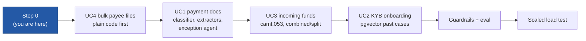
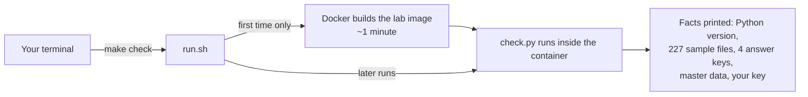

# ClearRail -- Step 0: get it running

ClearRail applies the CrossExam pattern to four cross-border payment operations problems for the fictional provider **Corridor Payments Ltd**: AI reads the papers and investigates, and plain code checks that they agree. Clean cases clear automatically; people see only the exceptions, with the evidence and a proposed fix.

| #   | Use case                                  | Who reviews the exceptions     | What a "case" is                        |
| --- | ----------------------------------------- | ------------------------------ | --------------------------------------- |
| 1   | Checking a payment's supporting documents | Payment operations, compliance | One outgoing payment and its papers     |
| 2   | Business customer onboarding (KYB)        | Onboarding, compliance         | One business application and its papers |
| 3   | Matching incoming funds                   | Treasury / cash operations     | One bank credit, or a group of them     |
| 4   | Checking bulk payee files                 | Payment operations             | One payee file, checked row by row      |

**The one design rule:** amounts, tolerances, matching, screening results and every release decision are plain code that agents call as a tool. An agent can make a route stricter, never looser. Releasing a payment, approving a customer or posting cash is never an agent tool.

**Data rule:** every company, person, account and number in `data/` is made up. No real client data, employer branding or real sanctions-list entries go into the repo.

The full spec is in [ClearRail_Use_Cases_and_Sample_Data.pdf](ClearRail_Use_Cases_and_Sample_Data.pdf).

## Why this step exists

You cannot build on what you cannot run. Before any agent, any check or any match rule, one command has to prove that Docker works, that the sample data pack is in place for all four use cases, and (once you have one) that your key is set. Nothing here calls a model, so step 0 costs nothing to run.

## What this step adds

- A small **Docker image** (`Dockerfile`, `pyproject.toml` + `uv.lock`, installed with uv): Python and the few libraries the first steps need.
- `run.sh`: runs any Python file of this repository inside that image, with the project folder mounted. Edit a file and run it again, with no rebuild.
- `check.py` and `make check`: a few plain facts, printed in seconds.
- `make setup`: creates `.env` from the template (it never overwrites one that already exists).

## Where this sits (build order)



## What happens inside this step



## Requirements

- **Docker Desktop**, running.
- **About a minute** the first time, while the image builds. Every later run starts at once.
- **No key needed for this step.** `make check` reports whether one is set, because step 1 is the first step that calls a model.

## Run it

```bash
make setup      # creates .env; put your Gemini key in it (not needed until step 1)
make check
```

A real run of this branch prints:

```
Python             3.12.16 (inside the lab image)
Sample data        227 files in data/
UC1 payment docs   30 cases (17 clear automatically), 104 files, answer key found
UC2 KYB onboarding 16 cases (6 clear automatically), 107 files, answer key found
UC3 incoming funds 40 cases (33 clear automatically), 5 files, answer key found
UC4 bulk payees    6 cases (2 clear automatically), 7 files, answer key found
Master data        found (master_data.json, payment_history.json, booked_deals.json, saved_payees.json)
Gemini key         set
Libraries          langchain 1.4.6, pypdf 6.21.1
```

## Where the files are

| Path                           | What it is                                                                                                                           |
| ------------------------------ | ------------------------------------------------------------------------------------------------------------------------------------ |
| `data/master/`                 | master data: 8 clients, 10 suppliers, watchlist, corridor rules, FX rates, approval limits, tolerances; payment history, booked deals, saved payees |
| `data/uc1_payment_documents/`  | 30 payments (one folder each): JSON instructions, PDF / scanned invoices, B/Ls and photos, export declarations, contracts           |
| `data/uc2_kyb_onboarding/`     | 16 applications (one folder each): JSON forms, certificates, Excel shareholder registers, SPECIMEN ID images, utility bills, bank letters |
| `data/uc3_incoming_funds/`     | camt.053 XML and CSV bank statement, remittance advices (PDF and .eml)                                                               |
| `data/uc4_bulk_payee_files/`   | 6 payee files: CSV, Excel with non-standard headers, a scanned PDF list                                                              |
| `data/*/ground_truth.json`     | the answer key for each use case: document types, expected fields, planted problem, expected codes and route                        |
| `run.sh`                       | runs a Python file inside the lab image                                                                                              |
| `.env`                         | your key, created by `make setup`, never committed                                                                                   |
